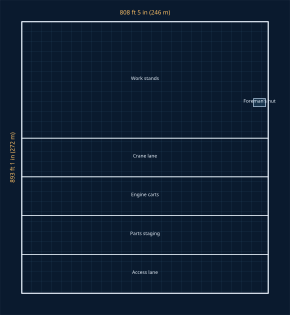

# P9-17 Work Yard 3: plan

Footprint 808 ft 5 in (246 m) × 893 ft 1 in (272 m) · structural grid 32 ft 10 in (10 m)

## Levels

| Level | Floor above deck | Height | Floor area |
|---|---|---|---|
| Level 1 · Ground | 0 ft (0 mm) | 13 ft 1 in (4,000 mm) | 1,033 sq ft (96 m²) |

## Elements

| ID | Designation | Type | Name | Level(s) | Size / length | Area | Status |
|---|---|---|---|---|---|---|---|
| E001 | D5F2P9B13A2R1 | zone | Work stands | L1 | 808 ft 5 in (246 m) × 382 ft 10 in (117 m) | 309,515 sq ft (28,755 m²) | proposed |
| E002 | D5F2P9B13A2R2 | room | Foreman's hut | L1 | 39 ft 4 in (12 m) × 26 ft 3 in (8,000 mm) | 1,033 sq ft (96 m²) | proposed |
| E003 | D5F2P9B13A2R3 | zone | Crane lane | L1 | 808 ft 5 in (246 m) × 127 ft 4 in (39 m) | 102,906 sq ft (9,560 m²) | proposed |
| E004 | D5F2P9B13A2R4 | zone | Engine carts | L1 | 808 ft 5 in (246 m) × 127 ft 7 in (39 m) | 103,172 sq ft (9,585 m²) | proposed |
| E005 | D5F2P9B13A2R5 | zone | Parts staging | L1 | 808 ft 5 in (246 m) × 127 ft 7 in (39 m) | 103,172 sq ft (9,585 m²) | proposed |
| E006 | D5F2P9B13A2R6 | zone | Access lane | L1 | 808 ft 5 in (246 m) × 127 ft 7 in (39 m) | 103,172 sq ft (9,585 m²) | proposed |

## Drawings

### Level 1 · Ground

