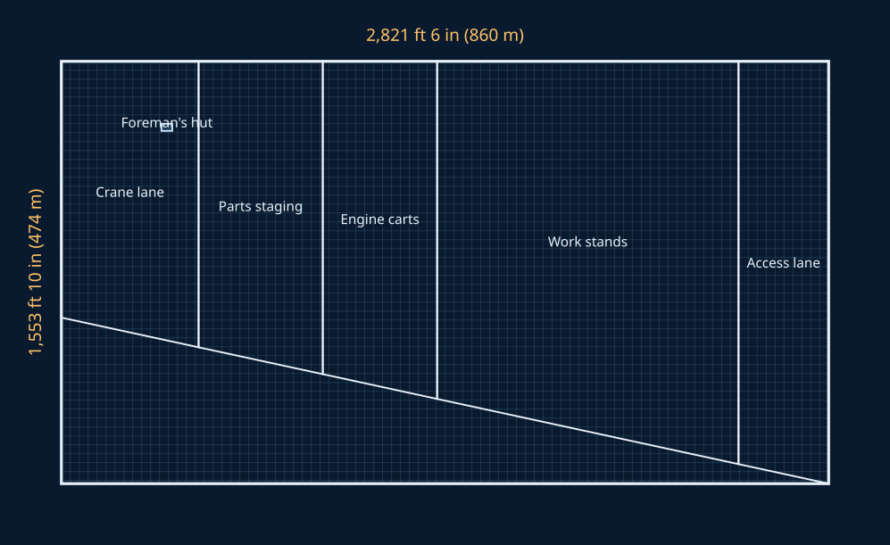

# P9-19 Work Yard 4: plan

Footprint 2,821 ft 6 in (860 m) × 1,553 ft 10 in (474 m) · structural grid 32 ft 10 in (10 m)

## Levels

| Level | Floor above deck | Height | Floor area |
|---|---|---|---|
| Level 1 · Ground | 0 ft (0 mm) | 13 ft 1 in (4,000 mm) | 1,033 sq ft (96 m²) |

## Elements

| ID | Designation | Type | Name | Level(s) | Size / length | Area | Status |
|---|---|---|---|---|---|---|---|
| E001 | D5F2P9B15A1R1 | zone | Crane lane | L1 | 504 ft 7 in (154 m) × 1,052 ft 2 in (321 m) | 503,352 sq ft (46,763 m²) | proposed |
| E002 | D5F2P9B15A1R2 | room | Foreman's hut | L1 | 39 ft 4 in (12 m) × 26 ft 3 in (8,000 mm) | 1,033 sq ft (96 m²) | proposed |
| E003 | D5F2P9B15A1R3 | zone | Parts staging | L1 | 456 ft 8 in (139 m) × 1,150 ft 11 in (351 m) | 503,066 sq ft (46,736 m²) | proposed |
| E004 | D5F2P9B15A1R4 | zone | Engine carts | L1 | 420 ft 7 in (128 m) × 1,242 ft 2 in (379 m) | 503,262 sq ft (46,755 m²) | proposed |
| E005 | D5F2P9B15A1R5 | zone | Work stands | L1 | 1,108 ft 3 in (338 m) × 1,481 ft 11 in (452 m) | 1,509,506 sq ft (140,238 m²) | proposed |
| E006 | D5F2P9B15A1R6 | zone | Access lane | L1 | 331 ft 4 in (101 m) × 1,553 ft 10 in (474 m) | 502,972 sq ft (46,728 m²) | proposed |

## Drawings

### Level 1 · Ground

