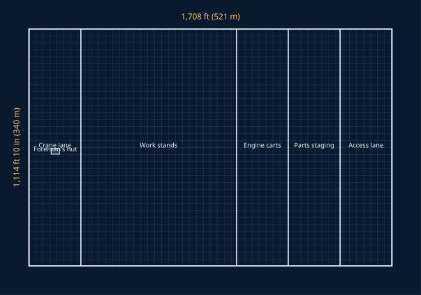

# P9-21 Work Yard 5: plan

Footprint 1,708 ft (521 m) × 1,114 ft 10 in (340 m) · structural grid 32 ft 10 in (10 m)

## Levels

| Level | Floor above deck | Height | Floor area |
|---|---|---|---|
| Level 1 · Ground | 0 ft (0 mm) | 13 ft 1 in (4,000 mm) | 1,033 sq ft (96 m²) |

## Elements

| ID | Designation | Type | Name | Level(s) | Size / length | Area | Status |
|---|---|---|---|---|---|---|---|
| E001 | D5F2P9B6A3R1 | zone | Crane lane | L1 | 244 ft 1 in (74 m) × 1,114 ft 10 in (340 m) | 272,124 sq ft (25,281 m²) | proposed |
| E002 | D5F2P9B6A3R2 | room | Foreman's hut | L1 | 39 ft 4 in (12 m) × 26 ft 3 in (8,000 mm) | 1,033 sq ft (96 m²) | proposed |
| E003 | D5F2P9B6A3R3 | zone | Work stands | L1 | 731 ft 11 in (223 m) × 1,114 ft 10 in (340 m) | 816,005 sq ft (75,809 m²) | proposed |
| E004 | D5F2P9B6A3R4 | zone | Engine carts | L1 | 244 ft 1 in (74 m) × 1,114 ft 10 in (340 m) | 272,124 sq ft (25,281 m²) | proposed |
| E005 | D5F2P9B6A3R5 | zone | Parts staging | L1 | 243 ft 9 in (74 m) × 1,114 ft 10 in (340 m) | 271,758 sq ft (25,247 m²) | proposed |
| E006 | D5F2P9B6A3R6 | zone | Access lane | L1 | 244 ft 1 in (74 m) × 1,114 ft 10 in (340 m) | 272,124 sq ft (25,281 m²) | proposed |

## Drawings

### Level 1 · Ground

